<!--
  SOUMIRYA SARANGI · PROFILE README · v5
  Assets live in ./assets/ (header, divider, icons). Commit them with this file.
  Palette: bg #0D1117 · accent #00D9FF · deep #0A3D62 · text #C9D1D9
-->



<div align="center">

<a href="https://www.linkedin.com/in/soumirya-sarangi"></a>
<a href="mailto:soumiryasarangi@gmail.com"></a>
<a href="https://code-arena-eta-mauve.vercel.app"></a>


</div>


## `01` &nbsp;·&nbsp; About

```yaml
name:      Soumirya Sarangi
studying:  B.Tech CSE @ Lovely Professional University · 2024 to 2028 · CGPA 8.4
focus:     backend and distributed systems, with applied ML
building:  a vertical search engine, a flash-sale ticketing system, a multi-region uptime monitor
looking:   SDE and AI/ML internships
```

I build backend systems and then measure them: load tests on the real deployment, failure drills, and models scored on data they never trained on. Every number below names the split or the setup it came from.


## `02` &nbsp;·&nbsp; Selected work

<table>
<tr>
<td width="50%" valign="top">

###  &nbsp;CodeArena

<a href="https://code-arena-eta-mauve.vercel.app"></a>
<a href="https://github.com/SoumiryaSarangi/CodeArena"></a>


*A campus contest needs a judge that survives hostile code and a burst of submissions in the last minute.*

Online judge and contest platform. Code runs in isolate sandboxes on separate Azure VMs; jobs move through Redis Streams with leases; scoreboards update live over SSE.

**0.4 s** median verdict, **2.1 s** p95 on a 500-submission burst with two judge VMs · **28** sandbox attacks contained nightly · **6 of 6** failure drills pass on production

<sub>`Go` · `NestJS` · `Next.js` · `PostgreSQL` · `Redis` · `Terraform`</sub>

</td>
<td width="50%" valign="top">

###  &nbsp;UDGAM

<a href="https://github.com/SoumiryaSarangi/Udgam"></a>


*Radar sees through cloud and darkness, but wind shadows and algae look almost the same as oil.*

Traces an oil spill in Sentinel-1 radar back to the ship that caused it. I built the detection stage: a CNN scene classifier that gates a U-Net, trained on 2,570 scenes.

**0.942** scene accuracy on the sealed 450-scene holdout · on validation, **0.757** pooled oil IoU and look-alike rejection **0.08 → 0.84** with the gate

<sub>`PyTorch` · `Python` · `OpenCV`</sub>

</td>
</tr>

<tr>
<td width="50%" valign="top">

###  &nbsp;TruthLens

<a href="https://github.com/SoumiryaSarangi/TruthLens"></a>


*Hindi and Punjabi forwards often arrive typed in Latin letters. TruthLens treats that as the main case, not an edge case.*

Returns a verdict, its sources and a calibrated confidence for a forward, or refuses when it isn't sure. It checks for an existing fact-check first, then retrieves evidence.

Test ECE **0.039** · live verdict rule passed on **350** fresh claims, **100 of 106** answers right · the report shows it still trails an evidence-blind control on macro-F1

<sub>`PyTorch` · `Hugging Face Transformers` · `FastAPI`</sub>

</td>
<td width="50%" valign="top">

###  &nbsp;Vault

<a href="https://github.com/SoumiryaSarangi/Vault"></a>


*A clinic with four ordinary computers and no IT staff still can't afford to lose a file.*

Self-healing object store. I wrote the data plane: storage nodes, the gateway, Reed-Solomon erasure coding, repair, and LAN mode across four physical laptops.

Close a laptop's lid and Vault declares it failed in **8 s** (demo mode), then rebuilds its pieces on the others · **4 + 2** pieces per object at **1.5x** storage

<sub>`Python` · `FastAPI` · `SQLite`</sub>

</td>
</tr>

<tr>
<td width="50%" valign="top">

###  &nbsp;Marbl

<a href="https://marbl-app.onrender.com"></a>
<a href="https://github.com/SoumiryaSarangi/Meat-freshness-analyzer"></a>

*Freshness at the counter is judged by eye, by someone with no time to be careful.*

Grades a cut of meat from a phone photo and routes it by physical size, measured against a card in the frame.

**94.2%** on 831 validation images, from a random split, so an upper bound until the leakage audit

<sub>`PyTorch` · `OpenCV` · `FastAPI`</sub>

</td>
<td width="50%" valign="top">

###  &nbsp;SenseiAI

<a href="https://exam-prep-ai-ebon.vercel.app"></a>
<a href="https://github.com/SoumiryaSarangi/ExamPrep-AI"></a>

*Most study tools want an account and an API key before the first session.*

Turns lecture PDFs into notes, flashcards, quizzes and timed exams, with SM-2 spaced repetition and a tutor that answers only from your own uploads.

Local-first on IndexedDB · demo mode needs no key

<sub>`Next.js` · `TypeScript` · `React`</sub>

</td>
</tr>
</table>

<sub>Also: <a href="https://github.com/SoumiryaSarangi/DM-Rewind">DM Rewind</a> (jump to any date in an Instagram DM export, offline) · <a href="https://github.com/SoumiryaSarangi/OS-CA-Automated-Deadlock-Detection-Tool">Deadlock Detective</a> (matrix and wait-for-graph detection, visualised) · <a href="https://github.com/SoumiryaSarangi/Image-Classifier-for-fashion-mnist-hog-svm">Fashion-MNIST with HOG + SVM</a> (91.36% test) · <a href="https://github.com/SoumiryaSarangi/ml-educational-chatbot">an ML chatbot with no LLM</a></sub>


## `03` &nbsp;·&nbsp; How I work

<table>
<tr>
<td width="33%" valign="top">

**Estimate, then measure**

I write the capacity estimate down before the load test, so the result shows which assumption was wrong.

</td>
<td width="33%" valign="top">

**Name the split**

Thresholds are set on validation, the holdout is opened once, and every number says which one it came from.

</td>
<td width="33%" valign="top">

**Ship it**

A result in a notebook is not a deliverable. I take projects through to something deployed that other people can use.

</td>
</tr>
</table>


## `04` &nbsp;·&nbsp; Toolkit

<div align="center">

<sub>**LANGUAGES**</sub>


<sub>**BACKEND & DATA**</sub>


<sub>**INFRASTRUCTURE**</sub>


<sub>**FRONTEND**</sub>


<sub>**MACHINE LEARNING**</sub>


</div>


## `05` &nbsp;·&nbsp; Activity

<div align="center">


<br /><br />



</div>


## `06` &nbsp;·&nbsp; Contact

<div align="center">

**Open to SDE and AI/ML internships.**

<br />

<a href="https://www.linkedin.com/in/soumirya-sarangi"></a>
<a href="mailto:soumiryasarangi@gmail.com"></a>

</div>


